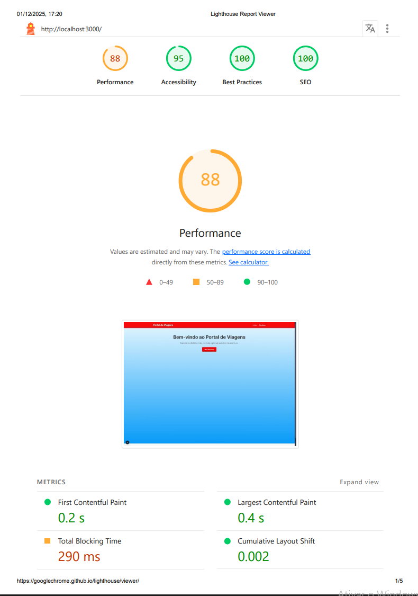
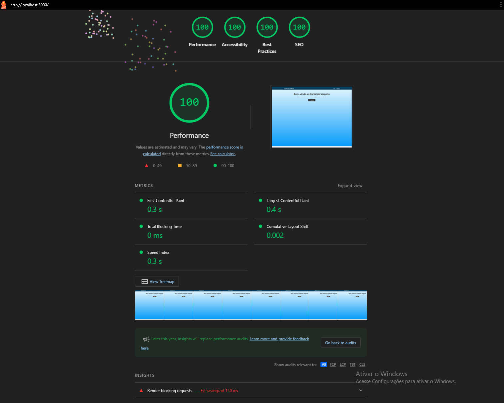

# Portal de Viagens

Portal de inspiração para viagens desenvolvido com Next.js, React e TypeScript. Explore oito destinos, filtre experiências e conheça atrações em páginas individuais.

O projeto mantém sua estrutura de componentes reutilizáveis e recebe uma apresentação editorial inspirada no [Visit the USA](https://www.visittheusa.com/pt-br/trip/amazing-family-experiences-across-the-usa/), com verde-sálvia, verde-floresta, fotografias em destaque e layouts responsivos.

## Funcionalidades

- **Página inicial:** fotografia em destaque, destinos selecionados e acesso às experiências.
- **Catálogo de destinos:** busca por nome ou região, sem diferenciação de acentos ou maiúsculas.
- **Filtros por experiência:** natureza, cultura, família e praia, com contagem dos resultados.
- **Filtro regional:** links da página inicial permitem explorar os destinos brasileiros.
- **Estado vazio:** mensagem e botão para limpar os filtros quando não há resultados.
- **Páginas individuais:** descrição, atrações, créditos das novas imagens e outros destinos para explorar.
- **Navegação:** cabeçalho com indicação da página ativa, rodapé e links internos com `next/link`.
- **Acessibilidade:** foco visível por teclado, link para pular ao conteúdo, textos alternativos e identificação dos filtros selecionados.
- **Metadados:** título e descrição para as páginas de destinos.
- **Exportação estática:** geração de HTML e arquivos de produção na pasta `out/`.

## Destinos disponíveis

| Destino | Região | Experiência |
| --- | --- | --- |
| Paris, França | Europa | Cultura |
| Tóquio, Japão | Ásia | Cultura |
| Rio de Janeiro, Brasil | América do Sul | Natureza |
| Sydney, Austrália | Oceania | Praia |
| Foz do Iguaçu, Brasil | América do Sul | Família |
| Fernando de Noronha, Brasil | América do Sul | Praia |
| Lençóis Maranhenses, Brasil | América do Sul | Natureza |
| Salvador, Brasil | América do Sul | Cultura |

As rotas dos destinos originais foram preservadas, incluindo `/destinos/tokio`.

## Tecnologias

- Next.js 15.5 com App Router
- React 19.1
- TypeScript 5
- CSS Modules e variáveis CSS globais
- ESLint com configuração do Next.js

## Executar localmente

Requisitos: Node.js 20 ou superior e npm.

```sh
git clone https://github.com/BigodeMarine/site-de-viagens.git
cd site-de-viagens
npm ci
npm run dev
```

Abra [http://localhost:3000](http://localhost:3000).

## Comandos

| Comando | Finalidade |
| --- | --- |
| `npm ci` | Instala as dependências conforme o arquivo de lock |
| `npm run dev` | Inicia o servidor de desenvolvimento |
| `npm run build` | Compila, valida tipos e gera o site estático em `out/` |
| `npm run lint` | Executa o ESLint |

O script `npm start` original utiliza `next start`, que não serve a configuração atual de exportação estática. Para visualizar a versão de produção, use um servidor estático:

```sh
npm run build
npx serve out
```

Abra o endereço informado pelo servidor.

## Publicação

Execute `npm run build` e publique o conteúdo de `out/` em uma hospedagem estática que resolva URLs sem extensão, como `/destinos/paris` para `/destinos/paris.html`.

A configuração está em `next.config.ts`:

```ts
const nextConfig = {
  output: "export",
  images: { unoptimized: true },
};
```

Não é necessário um servidor Next.js em produção. As imagens são servidas diretamente, sem o serviço de otimização de imagens do Next.js. O projeto usa fontes do sistema, evitando o download de fontes do Google durante a compilação.

## Organização do código

```text
src/
├── app/
│   ├── page.tsx                   # Página inicial
│   ├── layout.tsx                 # Layout e metadados globais
│   └── destinos/
│       ├── page.tsx               # Catálogo
│       └── [slug]/page.tsx        # Detalhes de cada destino
├── components/
│   ├── CardDestino/
│   ├── DestinationExplorer.tsx    # Busca e filtros
│   ├── Header/
│   └── Footer/
├── data/
│   └── destinos.ts                # Catálogo centralizado
└── styles/
    └── globals.css               # Paleta, tipografia e estilos compartilhados
public/
└── images/                       # Imagens dos destinos originais
```

## Adicionar um destino

Adicione um objeto ao array `destinos` em `src/data/destinos.ts`, seguindo a interface `Destino`. Informe um `id` e um `slug` únicos, nome, região, categoria, imagem, resumo, descrição e atrações. Os campos `credito` e `fonteImagem` são opcionais e permitem atribuir a fotografia e apontar para sua página de origem.

Use uma das categorias existentes para que o destino apareça no filtro correspondente: `Natureza`, `Cultura`, `Família` ou `Praia`. Para adicionar outra categoria, atualize também a lista em `DestinationExplorer.tsx`.

Imagens locais devem ficar em `public/images/` e ser referenciadas como `/images/nome-do-arquivo.webp`. Após alterar o catálogo, execute `npm run build` para gerar a nova página.

## Referência e imagens

A referência editorial para a atualização é o artigo [Experiências familiares incríveis por todos os EUA, do Visit the USA](https://www.visittheusa.com/pt-br/trip/amazing-family-experiences-across-the-usa/).

- As imagens dos quatro destinos originais permanecem em `public/images/`.
- As fotografias de Foz do Iguaçu, Fernando de Noronha e Salvador são carregadas do [Visit Brasil / Embratur](https://www.visitbrasil.com/).
- A fotografia dos Lençóis Maranhenses é de Jeferson Stader / MTur, publicada pelo [Ministério do Turismo](https://www.gov.br/turismo/pt-br/lencois-maranhenses-paisagem-unica-reconhecida-pela-unesco).
- Os créditos e links para as fontes estão registrados no catálogo e apresentados nas páginas individuais.
- O Visit the USA permanece apenas como referência visual; o catálogo não inclui destinos dos Estados Unidos.
- O carregamento dessas fotografias depende da disponibilidade da origem externa.

## Validação da atualização

- `npm run build` concluído com sucesso, incluindo checagem de TypeScript e geração estática.
- `git diff --check` sem erros.
- Links internos dos HTMLs exportados verificados, sem páginas de destino ausentes.
- Revisão visual e testes de interação em navegador ainda não realizados.

### Histórico de desempenho

As imagens abaixo pertencem à avaliação anterior registrada no projeto e não representam uma nova medição do visual atualizado.

Antes:



Depois:



Na etapa anterior, os dados foram centralizados em `src/data/destinos.ts`, os estilos compartilhados foram organizados em variáveis CSS e as imagens dos destinos originais foram convertidas para WebP.
